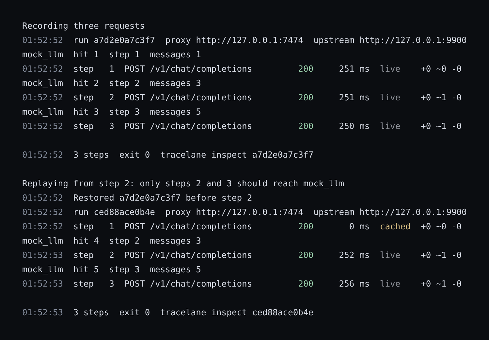
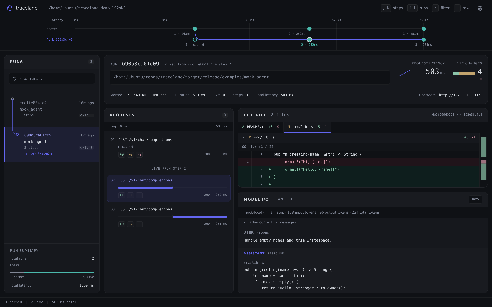

# Tracelane

Record model HTTP requests with workspace snapshots, inspect file diffs, and replay a run from a chosen step.

## Install

You need a Rust toolchain and a C compiler for bundled SQLite.

Linux native windows require GTK 3 and WebKitGTK 4.1 at runtime (`libgtk-3-0 libwebkit2gtk-4.1-0` on Ubuntu).
For Linux builds, install `libgtk-3-dev libwebkit2gtk-4.1-dev pkg-config`. Build a browser-only CLI with `cargo install --path . --no-default-features` to skip these dependencies.

```bash
git clone https://github.com/lainarchive/tracelane.git
cd tracelane
cargo install --path .
```

To build without installing:

```bash
cargo build --release
cargo test --all-targets
cargo clippy --all-targets -- -D warnings
```

## 10-second demo

```bash
scripts/demo.sh
```

The script builds the release binary and examples first. After the build, the demo takes a few seconds and needs no API keys. It uses Bash, `curl`, and the Linux `script` utility, with ports 9900 and 7474 free.

The mock agent writes Rust greeting functions, handles whitespace, and adds a test. The second response uses SSE. The script records all three requests, inspects step 2, then forks from step 2. The mock server prints three hits during recording and only two during replay: step 1 comes from the cache.

The script leaves its temporary workspace in place and prints a command to open it with `tracelane ui`. The mock server stops when the script exits. You can also run `cargo test` inside that workspace to check the generated code.



## Commands

### Record

```bash
tracelane record --target https://api.openai.com -- my-command arg
```

`--port` sets the local proxy port (default 7474). `--target` sets the upstream URL; when omitted, Tracelane uses `TRACELANE_UPSTREAM_URL`, then `https://api.openai.com`.

The child receives `OPENAI_BASE_URL=http://127.0.0.1:<port>/v1` and `ANTHROPIC_BASE_URL=http://127.0.0.1:<port>`. It must honor those variables and supply any authentication headers the upstream requires. Tracelane exits with the child's exit code.

### Inspect

```bash
tracelane inspect <run-id>
tracelane inspect <run-id> --step 2
```

Without `--step`, inspect lists endpoints, status codes, latency, cache use, and added/modified/deleted file counts. `--step` shows unified file diffs and trimmed request/response summaries. Binary and non-UTF8 files get a skip note.

### Replay

```bash
tracelane replay <run-id> --from-step 2
tracelane replay <run-id> --from-step 2 --target http://127.0.0.1:9900 -- my-command
```

`--from-step` is required and starts at 1. Replay restores the selected step's pre-request snapshot. Without a command, it stops after restoring files. With a command, it creates a fork linked to the parent run. Requests before the selected step use the parent's cached responses; requests from that step onward go upstream.

`--port` defaults to 7474. `--target` uses the same environment/default fallback as record; it does not inherit the parent's upstream URL.

Replay overwrites modified files and deletes non-ignored files absent from the snapshot. Save unrecorded work before running it.

### UI

```bash
tracelane ui
tracelane ui --browser --port 7480
```

By default, the `desktop` feature opens a native OS webview (not Electron) backed by an in-process server on a random loopback port. Closing the window shuts down the server. `--port` overrides the port; `--browser` prints the URL and serves until Ctrl-C, defaulting to port 7480. Builds with `--no-default-features` always use this browser-only behavior. Select a step to see file diffs and model I/O; use `j` and `k` to move between steps, or toggle Raw JSON for full payloads. The URL hash keeps the selected run and step across reloads. All assets are embedded in the binary.

Random native ports have separate browser-storage origins; pass a fixed `--port` to keep the same origin across launches.



## Developing the inspector

The React inspector lives in `ui/` (TypeScript, Vite, Tailwind and shadcn/ui).
Use Node 22.13 or newer and npm:

```bash
cd ui
npm ci
npm run build
npx vitest run
```

The build writes one self-contained `src/ui/index.html`. Commit it with frontend
changes; ordinary `cargo build` embeds this file and does not need Node. For local
development, run `tracelane ui --browser` in a recorded workspace and `npm run dev` in `ui/`.
Vite forwards `/api` to `127.0.0.1:7480`; all fonts, scripts and styles are local.

Open the gear menu (or press `,`) for theme, density, diff wrapping, timestamps
and selection accent. Settings and pane sizes are saved in the browser.

## How it works

The current directory is the workspace. Tracelane binds its proxy to localhost and forwards request methods, paths, query strings, bodies, and headers to the upstream, excluding transport headers such as `Host` and `Content-Length`.

A mutex serializes requests. Each request takes a pre-snapshot, forwards upstream, buffers the response, then takes a post-snapshot and writes a step to SQLite. JSON bodies are parsed. SSE bodies keep their original text and content type so cached SSE responses retain their bytes.

State lives under `.tracelane/`:

- `traces.db` uses SQLite WAL and stores runs, fork links, steps, and snapshot manifests.
- `blobs/<sha256>` stores file contents once per hash. A snapshot ID hashes its sorted manifest, so identical trees share a snapshot.

Workspace walks skip `.git`, `target`, `node_modules`, and `.tracelane` at any depth. Restore recreates snapshot files, removes other non-ignored files, and prunes empty directories. Ignored directories remain untouched.

During replay, a cached request must match the recorded JSON body, method, and path. A mismatch prints a warning and disables the remaining cache for that fork. Cached steps still take snapshots and are marked `cached` in the new run.

## Limitations

- Streaming responses are buffered until complete, including SSE.
- Snapshots capture file contents, not symlinks or permissions. Paths must be UTF-8.
- Snapshots bracket HTTP requests. Edits made after a response are outside that request's diff. The demo overlaps each local edit with the next request so the diffs contain real file changes; the final test-file write happens after the last response.
- Cached JSON is reserialized, so whitespace and object-key order may differ from the original response. SSE text is preserved.
- Replay restores local files and substitutes model responses. It does not undo external side effects from the child command.
- Payloads and workspace files may contain secrets. Keep `.tracelane/` private and out of version control. The local inspector has no authentication.
